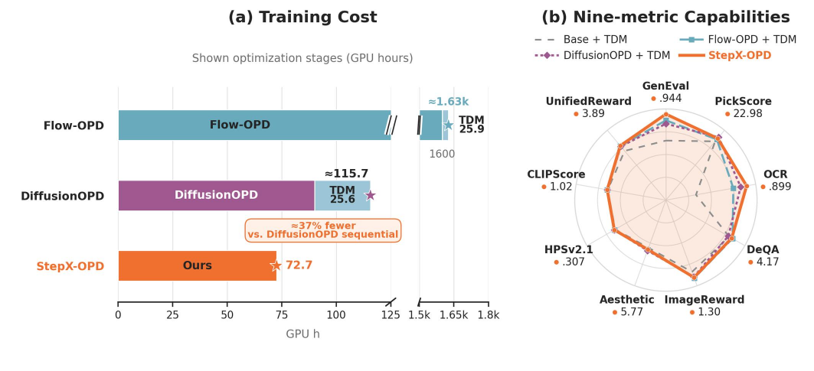
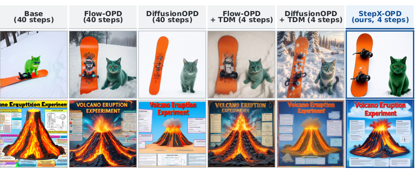

# StepX-OPD: Rethinking Multi-Teacher On-Policy Distillation in Diffusion Models

[](https://winterccc.github.io/Step-OPD/)
[](https://huggingface.co/ShimaRinC/StepX-OPD-SD3.5)
[](https://arxiv.org/abs/2611.04386)
[](https://huggingface.co/spaces/hugging-apps/stepx-opd)



*Training cost of each optimization stage, alongside four-step performance across the evaluated benchmarks.*

This repository trains a four-step SD3.5-Medium sampler by distribution matching against a set of frozen expert teachers, and it generates images from the result.

## Abstract

StepX-OPD trains a four-step sampler for SD3.5-Medium by combining capability integration and step distillation into a single training stage. Each training mini-batch is drawn from one of several sources, and the student is routed to the frozen specialist teacher associated with that source. Supervision is attached to states sampled from the student's own short rollout rather than to a fixed timestep grid, so the distribution-matching signal targets the states the student actually visits at inference time. The student's velocity is pushed toward the routed teacher's guided velocity through a trainable critic, and in the low-noise half of the rollout an additional direct velocity regression against the teacher is applied, weighted by a per-sample term taken from a marginal-KL decomposition of the matching objective. This repository covers that weighted variant, `w_b`, and is derived from the DiffusionOPD codebase, whose SD3 multi-teacher training script supplied the prompt datasets, the prompt-encoding path, and the low-rank adapter assembly.



*Qualitative comparison across six models, including StepX-OPD.*

## 🚀 Getting Started

### 1. Install

```bash
python -m venv .venv && source .venv/bin/activate
pip install -r requirements.txt
```

### 2. Prepare weights and data

| Asset | Link |
|---|---|
| SD3.5-Medium base | https://huggingface.co/stabilityai/stable-diffusion-3.5-medium |
| StepX-OPD LoRA weights (folded inference LoRA) | https://huggingface.co/ShimaRinC/StepX-OPD-SD3.5 |
| Three expert teacher adapters | https://huggingface.co/quanhaol/DiffusionOPD (published with the DiffusionOPD release) |
| SFT-augmented additive initialization | https://huggingface.co/ShimaRinC/StepX-OPD-SD3.5/tree/main/additive_init |

These are the `PLACEHOLDER` entries to fill in `configs/sd35m_wb.yaml`; the base model entry takes a local directory, not a hub id.

The additive initialization is a PEFT adapter directory. Download it with

```bash
huggingface-cli download ShimaRinC/StepX-OPD-SD3.5 --include "additive_init/*" --local-dir ./StepX-OPD-SD3.5
```

and pass `./StepX-OPD-SD3.5/additive_init` as `init_lora_merge_path` in `configs/sd35m_wb.yaml` for training, or as `--init_merge` to `scripts/generate_sd35_4step.py`. Training merges it into the SD3.5-Medium transformer before creating the rank-32 student adapters, so it is the starting point for training rather than a standalone four-step model.

### 3. Train

The reported setting uses 8 NVIDIA H800 GPUs with a per-rank batch size of 32, for a global batch size of 256.

```bash
GPUS=0,1,2,3,4,5,6,7 CONFIG=configs/sd35m_wb.yaml bash scripts/launch_train_wb.sh
```

`OVERRIDE` takes inline YAML merged over the config file, which is how to shorten a run or shrink the batch for a smoke test:

```bash
OVERRIDE='{max_train_steps: 40, train_batch_size: 4}' bash scripts/launch_train_wb.sh
```

### 4. Generate

```bash
python scripts/generate_sd35_4step.py \
    --base /path/to/stable-diffusion-3.5-medium \
    --init_merge ./StepX-OPD-SD3.5/additive_init \
    --adapter /path/to/checkpoint-step-<N> \
    --prompts prompts.json \
    --out_dir out/ \
    --seeds 0 --steps 4 --cfg 1.0 --size 512
```

`--init_merge` takes the `additive_init` directory downloaded above, and `--adapter` takes a checkpoint directory written by training with this code. This script uses the sampling grid the model is evaluated with. Substituting another sampling pipeline's default grid lowers the benchmark scores, most visibly on image quality.

### 5. Inference with diffusers

To generate images without the training code, load the folded inference LoRA directly with diffusers. It already contains the additive initialization, so `additive_init` is not needed here.

```python
import numpy as np
import torch
from diffusers import StableDiffusion3Pipeline

pipe = StableDiffusion3Pipeline.from_pretrained(
    "stabilityai/stable-diffusion-3.5-medium", torch_dtype=torch.bfloat16
).to("cuda")
pipe.load_lora_weights("ShimaRinC/StepX-OPD-SD3.5")

image = pipe(
    "a corgi wearing sunglasses, studio photo",
    num_inference_steps=4,
    guidance_scale=1.0,
    sigmas=np.linspace(1.0, 1.0 / 4, 4),
    height=512,
    width=512,
    generator=torch.Generator("cuda").manual_seed(0),
).images[0]
image.save("out.png")
```

## 🔁 Resuming a Run

```bash
GPUS=0,1,2,3,4,5,6,7 \
RESUME_FROM=/path/to/run/checkpoint/checkpoint-step-<N> \
    bash scripts/launch_train_wb.sh
```

The launch must use the same number of ranks and the same config that wrote the checkpoint, except for `output_dir`, `run_name`, `log_interval`, `save_interval` and `max_train_steps`. A checkpoint whose save did not finish is rejected.

## 🔗 Related Links

The paper is at https://arxiv.org/abs/2611.04386, the project page is at https://winterccc.github.io/Step-OPD/, and the trained weights are published at https://huggingface.co/ShimaRinC/StepX-OPD-SD3.5. An interactive demo runs on Hugging Face Spaces at https://huggingface.co/spaces/hugging-apps/stepx-opd. Thanks to Apolinário and the Hugging Face open-source team for building it.

## 📄 License

This project is licensed under the Apache-2.0 License (see [LICENSE](LICENSE)). Where accompanying materials in this repository are marked as subject to different license terms, such materials are governed by those terms.

Third-party components distributed with this project are licensed under their own terms (see [NOTICE](NOTICE)).

The model weights on Hugging Face are derived from Stable Diffusion 3.5 Medium and are distributed separately under the Stability AI Community License Agreement; see https://huggingface.co/ShimaRinC/StepX-OPD-SD3.5.

## 📚 Citation

```bibtex
@misc{wang2026stepxopdrethinkingmultiteacheronpolicy,
      title={StepX-OPD: Rethinking Multi-Teacher On-Policy Distillation in Diffusion Models}, 
      author={Chenru Wang and Xuanyang Zhang and Yucheng Han and Wenbo Nie and Wei Cheng and Xianfang Zeng and Gang YU and Chi Zhang},
      year={2026},
      eprint={2611.04386},
      archivePrefix={arXiv},
      primaryClass={cs.CV},
      url={https://arxiv.org/abs/2611.04386}, 
}
```

## 📭 Contact

For questions or issues, please open a GitHub issue in this repository.
